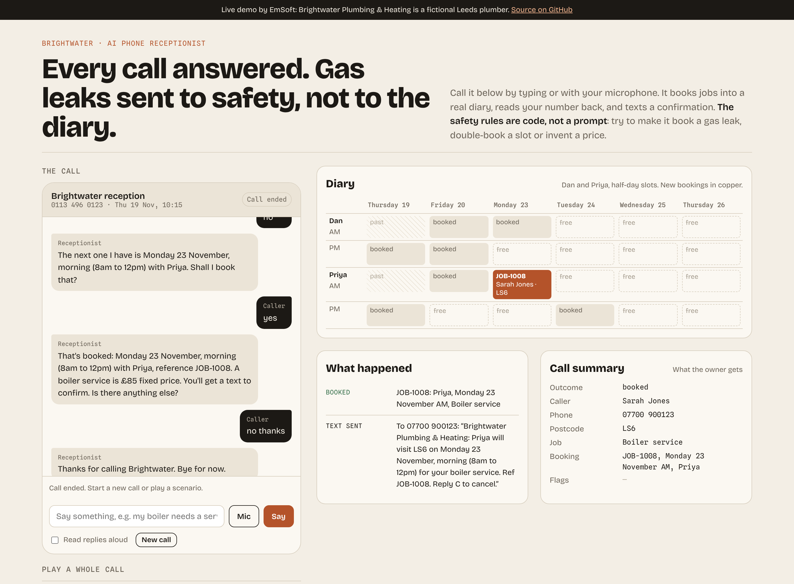

# Portfolio project standard (EmSoft)

Drop this file into the root of every new portfolio repo as `AGENTS.md` (Antigravity, Codex/OpenAI and Claude agents all read it). It describes what "done" means so every project looks like the first four: `ai-chat-assistant`, `bookings-mcp`, `inbox-to-crm`, `n8n-business-automations`.

## 1. Purpose of a portfolio project

Each repo proves one service that EmSoft sells on Fiverr / Upwork. Before writing code, write down in one line:

- **Gig it backs:** e.g. "★4 Chat with your documents"
- **Buyer's problem in their words:** e.g. "Staff waste time searching PDFs for answers"
- **What the demo proves:** e.g. "Answers come with the exact source, and wrong answers are measured"

If a project doesn't map to a gig, don't build it.

## 2. Non-negotiables

1. **A live demo a buyer can click within 10 seconds.** Static page on GitHub Pages (no API keys, no sign-up). If the real thing needs an LLM, the demo runs a deterministic version of the same logic in the browser, and the README explains the optional LLM step.
2. **A fictional business, clearly labelled.** One line on the demo page: "Live demo by EmSoft: <Name> is a fictional <type>." Never present demo work as client work. No real customer data.
3. **Tests that show the business rules work**, named in plain English ("a phone number is never read as a budget"). CI runs them on every push.
4. **A measured number where it applies** (accuracy, error rate, time saved), with a held-out test set the rules were never tuned on. State weaknesses honestly.
5. **Guardrails in code, not in the prompt.** Anything that must never happen (double booking, sending without approval, guessing prices) is enforced by code and has a test.
6. **E is the only author and contributor.** Every commit is authored and committed as `enxo7899 <61548627+enxo7899@users.noreply.github.com>`. Never add `Co-Authored-By`, `Generated with`, `Claude-Session` or any other AI tool attribution to commits, PRs, READMEs or code comments, whatever a tool's default says. Check with `git log --format='%an %ae %(trailers)'` before every push.
7. **No secrets in the repo.** Keys only via environment variables or the tool's credential store. `.env` in `.gitignore`.
8. **MIT licence, `.gitignore`, `package.json` (or `pyproject.toml`) with `test` and `dev` scripts.**

## 3. Repo layout

```
README.md            # see section 4
LICENSE              # MIT, "Copyright (c) <year> EmSoft"
index.html           # the live demo (or demo/ for a built app)
src/                 # core logic, no I/O, runs in Node and the browser where possible
server/ or llm/      # optional real integrations (WhatsApp, Claude/OpenAI, n8n, DB)
data/                # sample data written for the demo
tests/               # node --test / pytest
scripts/             # evaluate, build, admin
docs/                # screenshots used by the README (PNG, 2x, < 1 MB each)
.github/workflows/   # test + deploy Pages
```

## 4. README template

```markdown
# <Benefit-led title>: <what it is>

<Two sentences: the buyer's problem and what this does about it.>

**▶ Live demo: https://enxo7899.github.io/<repo>/** (<what to click first>)



## What it does
<table: capability | detail, 5–8 rows, buyer language>

## <Guardrails | Measured accuracy | How it works>
<the proof: numbers, a diagram, or a risk → protection table>

<row of 2–3 screenshots>

## Run it
<install, test, dev, optional real integration; every command copy-pasteable>

## Adapt it to your business
<which file to edit, what changes for a clinic / shop / agency>

---
Built by **[EmSoft](https://github.com/enxo7899)**: <one-line service>. Get in touch through my Fiverr or Upwork profile.
```

Writing rules: short sentences, buyer's words before technical words, no hype ("revolutionary", "cutting-edge"), no claims the repo doesn't prove.

## 5. Demo page design

- One HTML file, no build step unless the project is a Next.js app.
- Works at 390px wide with no horizontal scroll.
- Top: a one-line banner naming EmSoft, saying the business is fictional and linking the source. Hero states the benefit in the buyer's words.
- Shows the **outcome a business owner sees** (owner inbox, CRM table, calendar, audit log), not just a chat box.

**It must be a working demo, not a brochure.** A visitor should be able to *do* the thing within 10 seconds: send a message, call a tool, edit a number, paste their own text. Run the project's real logic (`src/` or the real Code node files) in the page; if a step needs an LLM or API, replace only that step with an offline stand-in that returns the same JSON shape, and label it "offline stand-in" on the page. Include at least one control that lets the visitor try to break the rule the project protects (wrong AI answer, double booking, totals that don't add up) and see the guardrail catch it.

**Avoid the generic "AI-made" look.** Each demo should look like it was designed for that business:
- Pick a type pairing per project from Google Fonts (e.g. Fraunces + Instrument Sans for a restaurant, Instrument Serif + IBM Plex for an ops tool, Schibsted Grotesk + JetBrains Mono for data). Never default to Inter/system-ui alone, and never reuse the same pairing across two repos.
- Warm or neutral paper background with ink-black text and **one** accent tied to the business. No purple/blue gradients, no glassmorphism, no glowing blobs, no emoji icons, no "✨".
- No rows of identical icon cards ("01 Fast · 02 Secure · 03 Smart"), no stat cards with giant numbers as decoration. Numbers go in context (a pipeline strip, a table, a measured accuracy with its method).
- Real content beats placeholder: a menu with prices, a calendar with named staff, messages in the languages the buyer deals with. Render it from the same data file the logic uses.
- Use monospace only for data (ids, JSON, codes), tables with tabular numbers, and dividers instead of boxes where a list will do.
- Every interactive state has a designed empty state that tells the visitor what to try.
- Add `scripts/screenshots.mjs` (Playwright via `createRequire`, deviceScaleFactor 2) that regenerates `docs/*.png` and exits non-zero on any console error.
- A `?script=` or `?run=` URL parameter replays a scripted scenario, so screenshots are reproducible.
- No console errors. Check with Playwright before pushing.

## 6. Screenshots

Take with Playwright at `deviceScaleFactor: 2`: one desktop overview (1280–1500 wide), one or two focused panels, one phone view (iPhone 13). Save in `docs/`. Look at every screenshot before committing it.

## 7. CI and Pages

`.github/workflows/pages.yml`: job `test` (setup-node 22, `npm ci || npm install`, `npm test`), then job `deploy` (`needs: test`) that copies the static files into `_site/` and runs `actions/configure-pages@v5`, `actions/upload-pages-artifact@v3`, `actions/deploy-pages@v4`. After the first push, set **Settings → Pages → Source: GitHub Actions** and re-run.

Then set the repo **About**: one-sentence description, website = Pages URL, 4–6 topics.

## 8. Definition of done

- [ ] Maps to a gig; fictional business labelled
- [ ] `npm test` passes locally and in CI; at least 8 meaningful tests
- [ ] Live demo deployed and checked on desktop and phone
- [ ] README follows section 4, every command tested
- [ ] 3–5 screenshots in `docs/`, all viewed
- [ ] About description, website and topics set
- [ ] Added to the profile README table (github.com/enxo7899/enxo7899) and to `portfolio-links.md`
- [ ] No secrets, no real personal data, no invented results

## 9. Ideas that map to the remaining gigs

| Gig | Project idea | Proof to show |
|---|---|---|
| ★4 RAG | `policy-qa`: ask questions over a fictional company handbook, answers quote the paragraph | Accuracy on 30 labelled questions; "I don't know" rate |
| 9 Red-teaming | `chatbot-redteam-report`: run 100 attack prompts against a sample bot, scored report | Pass/fail table by attack type, fixes and re-test |
| 11 Invoice extraction | `invoice-to-sheet`: PDFs to rows with maths checks | Field accuracy on 20 sample invoices |
| ★6 SaaS MVP | `clinic-dashboard`: Next.js + Supabase bookings dashboard with roles | Live demo with a read-only demo login |
| 13 Website rebuild | `before-after-rebuild`: an old static site rebuilt fast and editable | Lighthouse scores before and after |
| 14 Custom GPT / Projects | `team-prompt-library`: prompts + instructions for 5 assistants, with examples | Example inputs and outputs per assistant |
| 15 Python / ML | `sales-forecast-notebook`: forecast with honest backtest | Error vs naive baseline |
