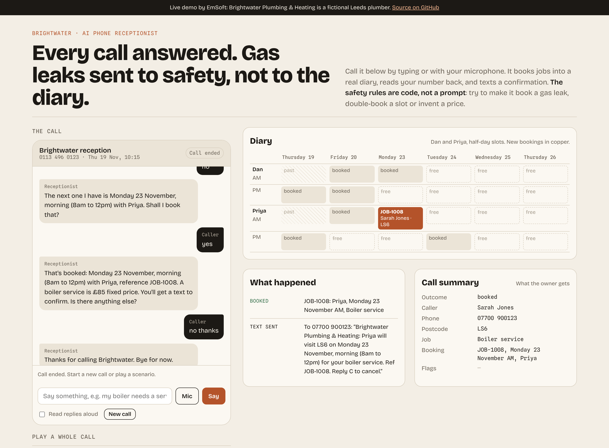
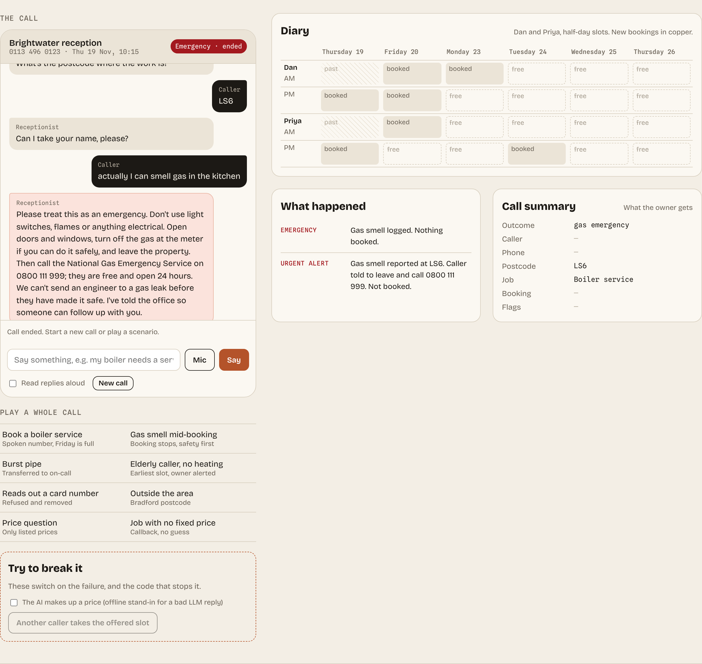
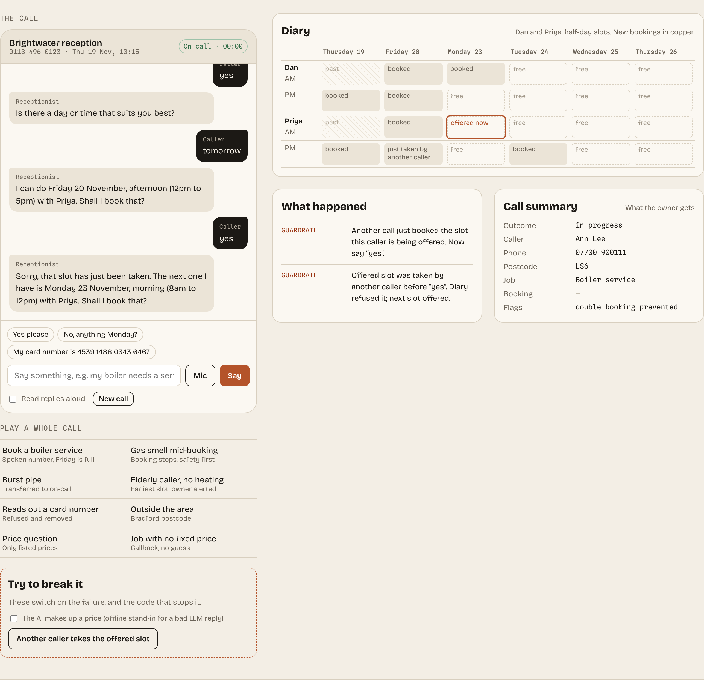
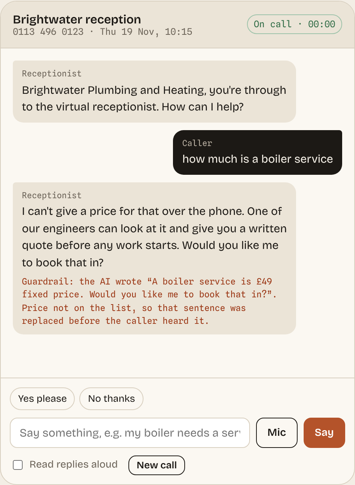
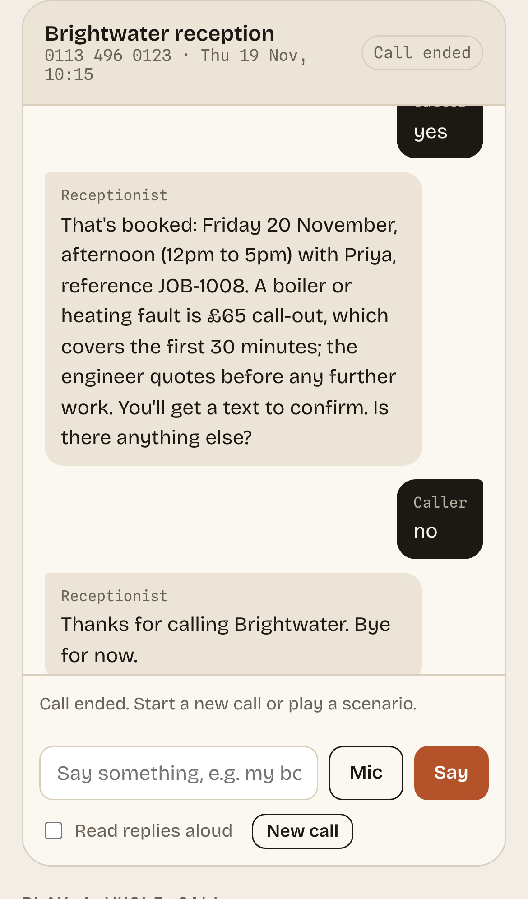

# AI phone receptionist for trades businesses: books jobs, sends emergencies to safety

Plumbers, electricians and heating engineers miss calls while they are on a job, and every missed call is a lost booking. This receptionist answers, books the job into the diary and texts a confirmation, while the rules that must never break (gas leaks, double bookings, made-up prices, card numbers) are enforced in code, not left to the AI's judgement.

**▶ Live demo: https://enxo7899.github.io/voice-receptionist/** (press "Book a boiler service", then try "Gas smell mid-booking")



## What it does

| Capability | Detail |
|---|---|
| Answers and books | Takes the job, postcode, name and number in any order, offers a free half-day slot and books it into the engineers' diary |
| Understands speech, not just typing | Reads "oh seven seven double oh nine hundred…", "L S six" and "my boyler" the way a speech-to-text engine actually returns them |
| Reads the number back | No booking until the caller has heard their number read back and said yes |
| Sends emergencies to safety | Gas smell or CO alarm: safety instructions and the gas emergency number, nothing booked. Burst pipe: stop-tap advice and a live transfer to the on-call engineer |
| Only real prices | Quotes from your price list; anything else gets "the engineer will quote", never a guess |
| Looks after vulnerable callers | An elderly person or a baby without heating gets the first slot and the owner gets an alert |
| Tells the owner what happened | Text confirmation, call summary, urgent alerts, messages for the office |
| Hands over cleanly | "Can I speak to a person?", or two turns it can't understand, transfers to the office |

## Guardrails

| Must never happen | What stops it (all in `src/policy.js`, `src/calendar.js`) | Test |
|---|---|---|
| A gas leak goes into the diary | Emergency check runs first on every turn; booking is blocked for the rest of the call | `a gas smell is never booked…` |
| The AI says a price you never set | Every £ amount in a reply is checked against the price list; the sentence is replaced before the caller hears it | `a price the AI makes up is replaced…` |
| Two callers get the same slot | The diary refuses a taken slot; the agent apologises and offers the next one | `two callers can never get the same slot` |
| A job is booked to a wrong number | `bookingBlockers()` requires a confirmed read-back | `no booking until the phone number has been read back…` |
| A visit outside your area | Postcode district checked against the service area | `nothing is booked outside the service area` |
| Card numbers in call logs | Luhn check on typed and spoken digits; refused and removed from the transcript | `card numbers are refused and never written…` |
| A caller stuck in a loop | Two misunderstood turns, or a request for a person, transfers to the office | `after two turns it cannot understand…` |

<p>


</p>
<p>


</p>

## Measured accuracy

Each test call is a scripted caller written the way speech-to-text returns speech: lower case, no punctuation, number words, "bowler" for boiler, postcodes spelled out. A call counts as right only if the outcome (booked, emergency, transfer, message…) **and** every detail (job, postcode, name, phone, flags) is right.

| Call set | Calls | Whole call right | Details right | Emergencies caught | Safety violations |
|---|---|---|---|---|---|
| **Unseen test calls, first run** | 30 | **27/30 (90%)**, 95% CI 74% to 97% | 97% of 67 | **5/5** | **0** |
| Test calls after fixing 2 bugs | 30 | 29/30 | 100% | 5/5 | 0 |
| Development calls (first run 24/30) | 30 | 29/30 | 100% | 5/5 | 0 |
| Tuning calls | 20 | 20/20 | 100% | 3/3 | 0 |

How the numbers were made, and what they don't prove:

- The rules were written against the 20 tuning calls. The 30 development calls were then run once (24/30, saved in `data/dev-first-run.txt`); that run found a real safety miss (water dripping through a ceiling light was not treated as an emergency), which was fixed.
- The 30 test calls were written after that and run **once**; the headline row is that run (`data/test-first-run.txt`). It found two real bugs ("it's overdue" taken as a name, "replace our old boiler" not recognised) and one mistake in a script. They were fixed afterwards, so the test set is now spent; the second row is not a fair score.
- Scripted callers don't interrupt, ramble or change their mind mid-sentence like real ones. Treat this as a regression suite that runs in CI, not a promise about live calls. Before going live with a client, record 50 real (consented) calls and add them.

`npm run evaluate` reruns everything and writes `data/evaluation.json`, which the demo page reads.

## Run it

Needs Node 20 or later. No dependencies.

```bash
git clone https://github.com/enxo7899/voice-receptionist.git
cd voice-receptionist
npm test            # 20 tests: guardrails, speech parsing, webhook
npm run evaluate    # scores the tuning, development and test calls
npm run dev         # demo on http://localhost:5173
```

Replay a call in the demo with `?run=booking`, `gas`, `flood`, `vulnerable`, `card`, `area`, `price` or `quote`. `npm run screenshots` regenerates `docs/` (needs Playwright installed globally).

### Connect it to a real phone line (Vapi or Retell)

The demo uses rules instead of an LLM so it runs without keys. On a real line, a voice platform does speech-to-text, the LLM and text-to-speech; this repo provides the tools the LLM must call, and the tools enforce the same guardrails.

```bash
WEBHOOK_SECRET=change-me npm run server     # http://localhost:8787
```

- **Vapi:** add the tools in `server/tools.schema.json` as custom function tools, set the server URL to `https://<your-host>/vapi`, and a credential that sends `Authorization: Bearer <WEBHOOK_SECRET>`. Use `server/system-prompt.md` as the assistant prompt. The server answers `tool-calls` messages with `{ "results": [{ "toolCallId", "result" }] }`.
- **Retell:** add custom functions pointing at `https://<your-host>/retell/<tool name>` (for example `/retell/book_job`). Set `RETELL_API_KEY` and `npm install retell-sdk` to have the `X-Retell-Signature` header verified.

What is enforced on a real line: emergency triage, service area, phone read-back, no double booking and card-number removal all sit inside the tools, so the LLM cannot get round them. The check on prices the LLM *speaks* (rather than reads from `get_price`) needs the platform's custom-LLM mode, where every reply passes through `guardReply()` before text-to-speech; that wiring is not included here. The diary is in memory; in production point `src/calendar.js` at your booking system or a database.

## Adapt it to your business

Everything business-specific is in `data/business.json`:

- **Services and prices:** the `services` list. A `price` of `null` means "free survey, quote after", so the receptionist never names a figure.
- **Area:** `serviceArea` postcode districts.
- **Engineers and diary:** `engineers` and `booked`; slots are morning and afternoon.
- **Emergencies:** on-call engineer and number in `onCall`.

For an electrician, swap gas for "burning smell / sparking socket" in `EMERGENCY` (`src/nlu.js`) and the safety script in `src/policy.js`. For a clinic or salon, drop the emergency rules and keep booking, read-back and no-double-booking. Then add 20 calls in your customers' words to `data/calls-tune.json` and keep a fresh set aside for testing.

---
Built by **[EmSoft](https://github.com/enxo7899)**: AI receptionists, chatbots and automations for small businesses. Get in touch through my Fiverr or Upwork profile.
